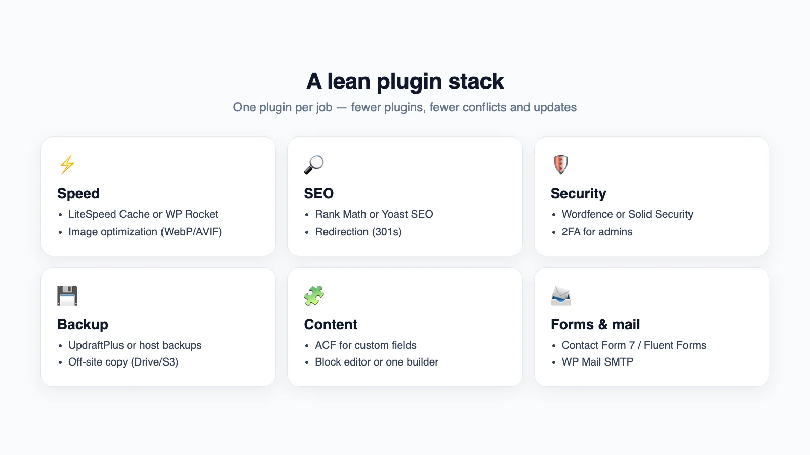
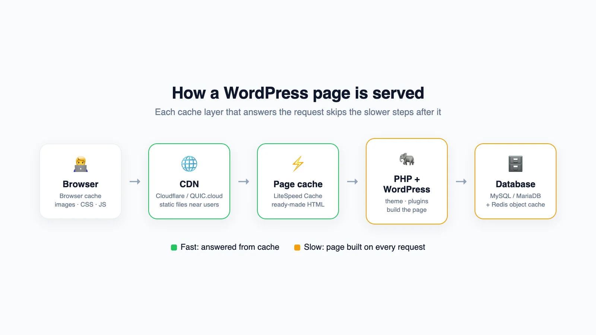
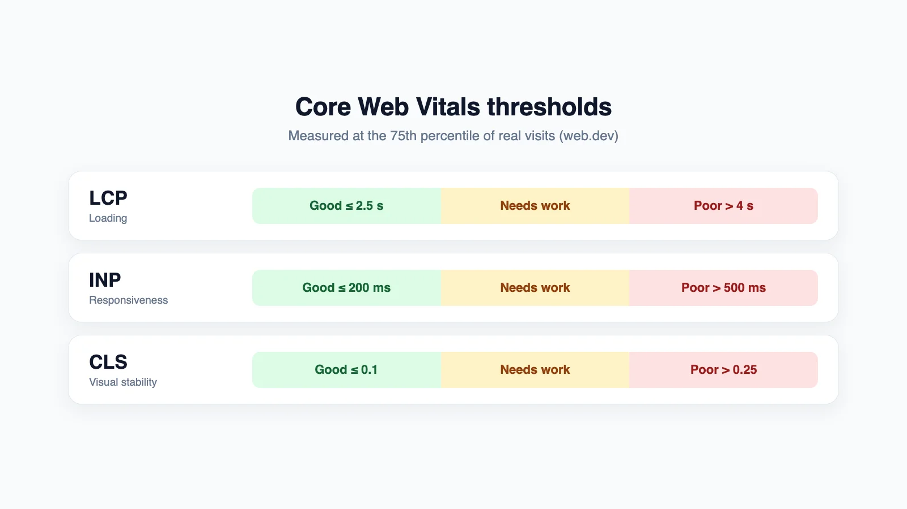

After more than two years of building WordPress and WooCommerce sites for businesses, one lesson stands out: WordPress is not slow or insecure by nature — **how it is built** decides that. This post collects the whole process I use, from choosing hosting to handover, with the latest numbers and a checklist you can apply right away.

## WordPress in 2026, in numbers

- According to W3Techs (data from 15 October 2026), WordPress runs **39.7% of all websites** and **58.5% of websites with a known CMS** — still the most popular platform.
- The latest version is **WordPress 7.1.3** (released 6 October 2026). The 7.0 branch still gets security fixes (7.0.7 the same day).
- Official recommendations: **PHP 8.3 or newer**, **MySQL 8.0+** or **MariaDB 10.11+**, and HTTPS. PHP 7.4 still runs but is end-of-life — avoid it.

WordPress's share of the whole web has dipped slightly over the past few years as Shopify, Wix and frameworks like Next.js grew. For business sites, blogs, news and small-to-medium stores, though, it remains the best balance of cost, build speed and self-managed content.

## When to use WordPress (and when not to)

**Use it for:**
- Company sites, landing pages, blogs and news — content updated often by people who don't code.
- Small and medium stores (WooCommerce) where you want to own your data and avoid revenue-based fees.
- Strong SEO on a budget: the SEO, schema and sitemap ecosystem is very mature.

**Consider something else when:**
- The app has complex business logic (wallets, reconciliation, layered permissions) — I chose Next.js + PostgreSQL for Hoàn Hời.
- The site is tiny and almost never changes — a static page is lighter and cheaper.
- It's a very large store with traffic spikes and no one to run servers — a SaaS platform may be safer.

## 1. Hosting and environment

Hosting is the foundation: no amount of code tuning saves a weak server. What I check before committing:

| Item | Aim for | Why |
|---|---|---|
| PHP | 8.3+ | Faster and still receives security fixes |
| Database | MariaDB 10.11+ / MySQL 8.0+ | Official recommendation |
| Web server | LiteSpeed or Nginx | Server-side page cache, HTTP/3 |
| Object cache | Redis or Memcached | Fewer repeated database queries |
| HTTPS | Auto-renewing Let's Encrypt | Required by browsers and SEO |
| Backups | Daily, stored off the server | Recovery when something breaks |
| Staging | A test environment | Update plugins without fear |
| Server location | Close to users (Singapore for Vietnam) | Lower response time |

## 2. Themes: fewer, better

Three main routes:

1. **A custom theme from a Figma design** — what I do for most clients. It contains only what the design needs, so it's light and scores well on Core Web Vitals. Pair it with **ACF** so clients can edit each block without breaking the layout.
2. **A block theme (Full Site Editing)** — headers, footers and templates built in the block editor. Great for content sites with little custom logic.
3. **A premium theme + page builder** — fast to start, but usually ships lots of unused CSS/JS. If you go this way, use **one** builder and switch off unused modules.

Ground rules:
- Keep customisations in a **child theme** or a small plugin; never edit the parent theme.
- Never use "nulled" (pirated) themes or plugins — the most common malware source I've seen when taking over sites.
- Avoid sliders and heavy effects above the fold; they hurt LCP directly.

## 3. Plugins: one job, one plugin



The number of plugins matters less than **quality and overlap**. Two cache plugins, or three plugins all adding schema, are classic causes of bugs. My usual base set:

- **Speed:** LiteSpeed Cache (on LiteSpeed servers) or WP Rocket; an image optimiser for WebP/AVIF.
- **SEO:** Rank Math or Yoast SEO; Redirection for 301s.
- **Security:** Wordfence or Solid Security, with two-factor auth for admins.
- **Backup:** UpdraftPlus or the host's backups, always with an off-site copy.
- **Content:** ACF for custom fields.
- **Forms & mail:** Contact Form 7 or Fluent Forms; WP Mail SMTP so mail doesn't land in spam.

Before installing anything new I check: last update, active installs, compatibility with the current WordPress version, and whether a few lines in the theme could do the job instead.

## 4. Speed and Core Web Vitals

### How a page is served



On every visit WordPress runs PHP, loads the theme and plugins and queries the database to build HTML. The goal is to **answer as many requests from cache as possible**: browser → CDN → page cache → object cache → database.

### The targets



Google measures Core Web Vitals on real-user data at the **75th percentile**:

- **LCP** (main content shown): good ≤ 2.5 s, poor > 4 s.
- **INP** (responsiveness): good ≤ 200 ms, poor > 500 ms. INP replaced FID on 12 March 2024.
- **CLS** (layout stability): good ≤ 0.1, poor > 0.25.

### My speed checklist

**Images — usually culprit number one**
- Export at the displayed size; don't ship a 4000px image into an 800px slot.
- Use WebP or AVIF at roughly 75–85% quality.
- **Don't lazy-load** the hero (LCP) image and give it priority (`fetchpriority="high"`); lazy-load everything below.
- Always set `width` and `height` to avoid layout shift.

**CSS, JavaScript and fonts**
- Remove unused plugins/modules instead of just hiding them.
- Defer non-critical JavaScript; keep third-party scripts (chat, pixels, widgets) to a minimum.
- Self-host fonts, load only the weights you use, use `font-display: swap`.

**Cache and server**
- Enable page cache; exclude cart, checkout and account pages on WooCommerce.
- Enable an object cache (Redis) for query-heavy sites.
- Serve static files through a CDN; enable Brotli/Gzip and HTTP/2 or HTTP/3.
- Upgrade PHP to the recommended version.

**Database**
- Limit stored revisions, clear expired transients and optimise tables regularly.

A few settings I often add to `wp-config.php`:

```php
// Keep at most 5 revisions per post
define( 'WP_POST_REVISIONS', 5 );

// Disable the theme/plugin file editor in wp-admin
define( 'DISALLOW_FILE_EDIT', true );

// Give WordPress more memory when needed
define( 'WP_MEMORY_LIMIT', '256M' );
```

And housekeeping with WP-CLI:

```bash
wp transient delete --expired
wp db optimize
```

### Measure before and after

I always run **PageSpeed Insights** before and after and keep the results for the client. Lighthouse lab scores fluctuate; the **real-user data** section is what Google actually uses.

## 5. Technical SEO for WordPress

- **Permalinks** like `/%postname%/` — short, keyword-friendly, chosen once and kept.
- **XML sitemap** submitted to Google Search Console.
- Unique **titles and descriptions** per page; one H1 per page.
- **Schema** (Organization, Article, Product, Breadcrumb…) managed by a single plugin to avoid duplicates.
- Correct **canonicals** for paginated pages and product filter parameters.
- Complete **301 redirects** when URLs change or when migrating from another platform — this decides whether rankings survive.
- **Hreflang** for multilingual sites.
- Sensible **robots** rules: keep internal search and cart pages out of results.

When migrating from an old platform (Haravan, Shopee, a hand-coded site), I build an **old URL → new URL map** first, import data with scripts, then verify in Search Console after launch.

## 6. Notes for WooCommerce

- Enable **HPOS** (High-Performance Order Storage) — orders live in dedicated tables instead of the posts table, so order queries are faster; it's the default for new stores in recent WooCommerce versions.
- Make sure caching **excludes** cart, checkout, account pages and session cookies.
- Keep product images in one ratio (usually 1:1) for a tidy, stable catalogue — my [Image Resizer](https://hoangpham.is-a.dev/image-resizer/) tool exists for exactly this.
- Avoid hundreds of unnecessary variations; use filterable attributes instead.
- Watch background jobs (Action Scheduler) so failed tasks don't pile up.
- Re-test the full checkout, emails and payment gateway after **every major update**.

## 7. Security: prevention beats cleanup

Most hacked sites I've cleaned had outdated plugins/themes, nulled software, or weak passwords. Checklist:

- **Update** core, themes and plugins regularly — test on staging first for important sites.
- **Two-factor auth** for every admin; strong passwords; no `admin` username.
- **Least privilege**: writers only need Editor or Author roles.
- Limit login attempts; consider disabling XML-RPC if unused.
- Disable the file editor in wp-admin (`DISALLOW_FILE_EDIT`).
- Use a **WAF/firewall** (from your security plugin or Cloudflare).
- **3-2-1 backups**: 3 copies, 2 storage types, 1 off-site — and **test a restore** at least once.
- Remove unused plugins, themes and accounts entirely.

## 8. My workflow

1. Build **locally** with Docker or LocalWP; keep custom themes/plugins in **Git**.
2. Push to **staging** for client review.
3. Deploy to production; use **WP-CLI** for repeatable tasks:

```bash
# Update core and plugins
wp core update
wp plugin update --all

# Change the domain after a move (try --dry-run first)
wp search-replace 'https://staging.example.com' 'https://example.com' --dry-run
```

4. Measure speed, check SEO, submit the sitemap, switch on backups and monitoring.

## WordPress handover checklist

- [ ] PHP 8.3+, HTTPS, one consistent www/non-www redirect
- [ ] Page cache, CDN, WebP/AVIF images, hero image not lazy-loaded
- [ ] Core Web Vitals "good" on mobile
- [ ] Sitemap in Search Console, correct robots, no duplicate schema
- [ ] Full 301 redirects for migrated sites
- [ ] 2FA for admins, correct roles, file editor disabled
- [ ] Automatic off-site backups, restore tested
- [ ] Contact forms sending via SMTP and tested
- [ ] Admin guide for the client

## Wrapping up

In 2026 WordPress is still a strong choice for most business websites — as long as it's built lean: just enough theme, no overlapping plugins, layered caching, and regular updates and backups. If you need a rebuild, a speed-up or a migration to WordPress, see my [services](/en/services) or [get in touch](/en/contact).

## Sources

- [W3Techs — Usage statistics of WordPress](https://w3techs.com/technologies/details/cm-wordpress) (data from 15 October 2026)
- [WordPress.org — Releases](https://wordpress.org/download/releases/)
- [WordPress.org — Requirements](https://wordpress.org/about/requirements/)
- [web.dev — How the Core Web Vitals thresholds were defined](https://web.dev/articles/defining-core-web-vitals-thresholds)
