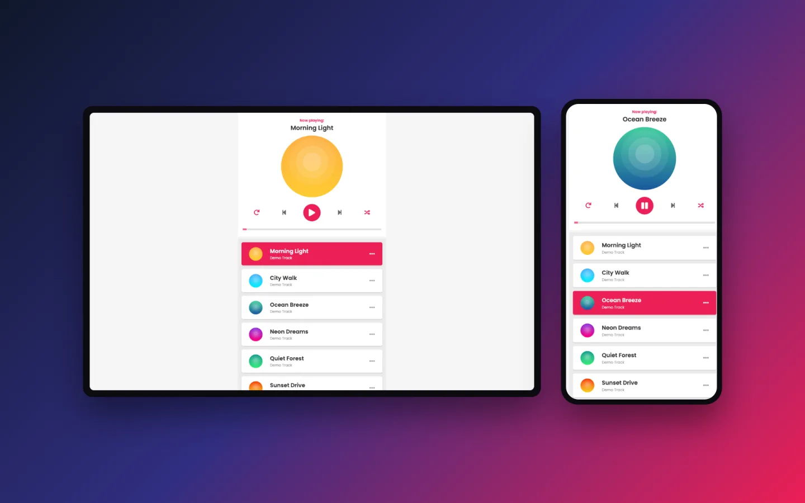
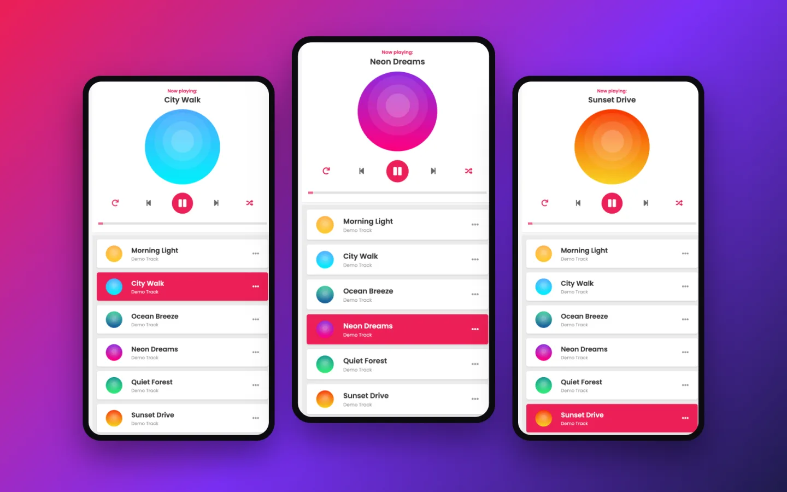

## Tổng quan

Trình phát nhạc dạng single-page lấy cảm hứng từ Zing MP3, xây dựng bằng HTML, CSS và JavaScript thuần — không dùng framework, không cần bước build.

- **Vai trò:** Dự án cá nhân
- **Năm:** 2024
- **Website:** [hoangpham.is-a.dev/zing-mp3-clone](https://hoangpham.is-a.dev/zing-mp3-clone/)
- **Mã nguồn:** [github.com/hoangpham2263/zing-mp3-clone](https://github.com/hoangpham2263/zing-mp3-clone)

## Tính năng

- Khu vực "đang phát" hiển thị tên bài hát và đĩa CD hình tròn xoay khi nhạc đang phát
- Phát/tạm dừng, bài trước, bài tiếp theo và thanh tiến trình có thể tua, đồng bộ với quá trình phát
- Chế độ phát ngẫu nhiên không bao giờ lặp lại bài đang phát, và chế độ lặp lại bài hiện tại
- Playlist làm nổi bật bài đang phát và tự cuộn tới bài đó; bấm vào bài bất kỳ để phát
- Đĩa CD thu nhỏ và mờ dần khi cuộn playlist
- Lưu cài đặt phát ngẫu nhiên và lặp lại vào `localStorage`

## Ảnh chụp màn hình

## Công nghệ

- HTML5 `<audio>` và range input
- CSS3 với font Poppins
- JavaScript thuần (ES6), Web Animations API cho hiệu ứng đĩa CD xoay
- Hosting trên GitHub Pages
